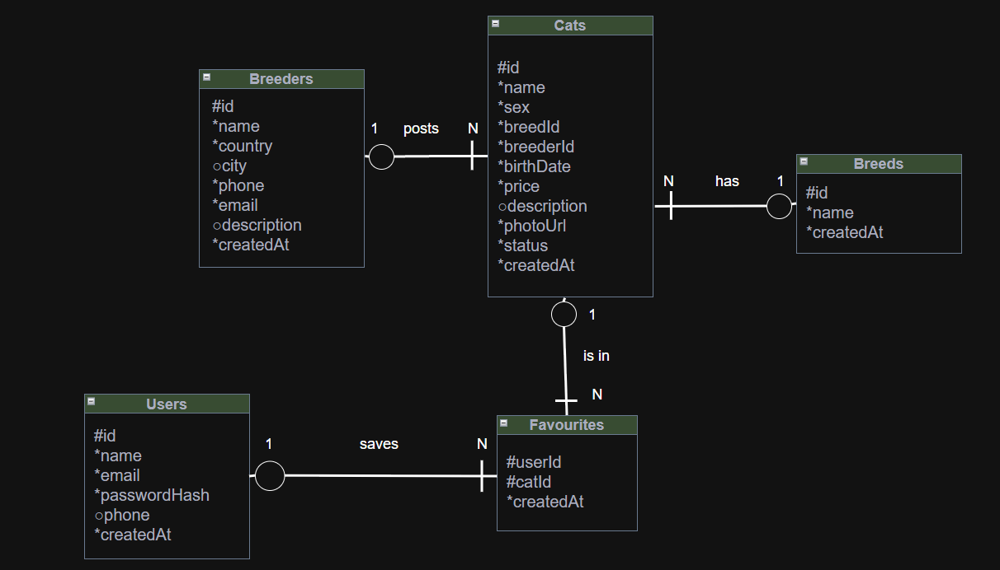

# Purrfect Home (онлайн магазин котів)
**Референс**: [LAPA shop](https://lapa.shop/en/the-lapa-universe/)
## Опис
На меті створити функціональний сайт, який слугуватиме маркетплейсом для продажу/покупки котиків.

### Функції для користувачів
Користувачі матимуть змогу:
- реєструватись, логінитись
- переглядати та редагувати свій профіль (для авторизованих користувачів)
- переглядати каталог
- переходити на окремі сторінки для отримання повної інформації
- зберігати котиків у "обране" (для авторизованих користувачів)
- шукати котів через поле пошуку за ім'ям
- фільтрувати за породою, ціною, віком, країною тощо
- сортувати за ціною, датою, віком тощо
- переглядати профіль заводчика і бачити усіх його/її котів  

*Оскільки коти - це не просто товар, а живі істоти, то кошик не передбачений.
Очікується, що покупці зв'язуватимуться з менеджером/заводчиком для уточнення деталей.*

### Функції для заводчиків (продавців):
*Припускаємо, що заводчики для публікації оголошень зв'язуються з адміністратором та надають йому необхідну інформацію.
Тобто, самостійно вони не можуть керувати своїми оголошеннями.
"Заводчики" будуть окремою сутністю для забезпечення відображення повної інформації для користувачів.
Їхня реєстрація/авторизація не передбачена.*

### Функції для адміністратора:
Адміністратор матиме змогу:
- додавати/редагувати/видаляти оголошення заводчиків через адмін-панель  
- змінювати статус оголошення

*Припускаємо, що адміністратор підтверджує офіційний статус заводчика, реєструє його в БД і тільки тоді створює оголошення.*

## Сторінки сайту
- Основна (Home) — містить опис сайту, відповіді на поширені питання тощо
- Коти (каталог) + можливість перейти на сторінку окремого кота
- Заводчики + можливість переходу на сторінку окремого заводчика
- Для покупців — інформація, яку покупці повинні знати перед покупкою
- Для заводчиків — інформація, яку повинні знати заводчики перед розміщенням оголошень
- Контакти —  способи зв'язку з адміністрацією
- Профіль — для авторизації, логіну, або переходу на свій профіль для вже авторизованих користувачів

## Ендпоінти

- **GET /cats** (отримати весь каталог котів)

**Параметри**: (усі необов'язкові)  

| Параметри          | Тип     | Опис                                           |
|--------------------|---------|------------------------------------------------|
| search             | string  | знайти за ім'ям                                |
| breedId            | integer | фільтр за породою                              |
| breederId          | integer | фільтр за заводчиком                           |
| country            | string  | фільтр за країною заводчика                    |
| minPrice, maxPrice | integer | мінімальна, максимальна ціна (в грн)           |
| minAge, maxAge     | integer | мінімальний, максимальний вік (у місяцях)      |
| status             | string  | фільтр за статусом (available, reserved, sold) |
| sortBy             | string  | сортувати за price, age, createdAt             |
| page, limit        | integer | пагінація                                      |  
| order              | string  | asc, desc                                      |

**Відповідь**:  
200 (OK):
```json
{
  "items": [
    {
      "id": 15,
      "name": "Murka",
      "sex": "female",
      "breed": { "id": 3, "name": "Scottish fold" },
      "birthDate": "2026-02-10",
      "price": 12000,
      "country": "Ukraine",
      "status": "available",
      "photoUrl": "https://example.com/cats/15.jpg"
    }
  ],
  "page": 1,
  "limit": 20,
  "total": 42
}
```
400 (Bad Request): некоректний запит  

- **GET /cats/{id}** (отримати інформацію про конкретного кота)  

**Відповідь**:  
200 (OK):
```json
{
  "id": 15,
  "name": "Murka",
  "sex": "female",
  "breed": { "id": 3, "name": "Scottish fold" },
  "breeder": { "id": 1, "name": "Ivan Petrenko" },
  "birthDate": "2026-02-10",
  "country": "Ukraine",
  "price": 12000,
  "description": "...",
  "status": "available",
  "photoUrl": "https://example.com/cats/15.jpg",
  "createdAt": "2025-01-15T10:30:00Z"
}
```
404 (Not Found)

- **POST /cats** (створити оголошення про кота)  

**Поля Request Body**: (усі, крім опису, обов'язкові)

| Поля        | Тип     | Опис                 |
|-------------|---------|----------------------|
| name        | string  | ім'я                 |
| sex         | string  | стать (male, female) |
| breedId     | integer | ID породи            |
| breederId   | integer | ID заводчика         |
| birthDate   | string  | дата_народження      |
| price       | integer | ціна (в грн)         |
| description | string  | опис                 |
| photoUrl    | string  | посилання на фото    |

**Відповідь**:  
201 (Created): успішно створено  
400 (Bad Request): некоректні дані
```json
{
  "message": "Validation error",
  "errors": [{ "field": "price", "message": "Price is required" }]
}
```
404 (Not Found): такого заводчика не існує

- **PATCH /cats/{id}** (редагувати оголошення про конкретного кота)  

**Request Body**: 
```json
{ 
  "status": "reserved", 
  "price": 11000
}
```
**Відповідь**:  
200 (OK): успішно змінено  
400 (Bad Request): некоректні дані  
404 (Not Found): кота/заводчика не існує

- **DELETE /cats/{id}** (видалити конкретне оголошення про кота)  

**Відповідь**:  
204 (No Content): успішно, нічого повертати  
404 (Not Found): кота не знайдено

- **GET /breeders** (отримати інформацію про усіх заводчиків)  

**Відповідь**:  
200 (OK):  
```json
[
  {
    "id": 1, 
    "name": "Ivan Petrenko", 
    "country": "Ukraine", 
    "city": "Kyiv"
  }
]
```

- **GET /breeders/{id}** (отримати інформацію про конкретного заводчика)  

**Відповідь**:  
200 (OK):  
```json
{
  "id": 1,
  "name": "Ivan Petrenko",
  "country": "Ukraine",
  "city": "Kyiv",
  "phone": "+380501234567",
  "email": "ivan@example.com",
  "description": "..."
}
```
404 (Not Found)

- **POST /breeders** (створити заводчика)

**Поля Request Body**:

| Поля        | Тип      | Опис                         |
|-------------|----------|------------------------------|
| name        | string   | ім'я (обов'язково)           |
| country     | string   | країна (обов'язково)         |
| city        | string   | місто                        |
| phone       | string   | номер телефону (обов'язково) |
| email       | string   | ел. пошта (обов'язково)      |
| description | string   | опис                         |

**Відповідь**:  
201 (Created)  
400 (Bad Request)  

- **PATCH /breeders/{id}** (редагувати інформацію про конкретного заводчика)  

**Request Body**: поля з POST /breeders  
**Відповідь**:  
200 (OK)  
400 (Bad Request)  
404 (Not Found)  

- **DELETE /breeders/{id}** (видалити заводчика з системи)

**Відповідь**:  
204 (No Content)    
404 (Not Found)  
409 (Conflict): у заводчика ще лишились оголошення

- **POST /auth/register** (зареєструватись)  

**Поля Request Body**:

| Поля     | Тип      | Опис                    |
|----------|----------|-------------------------|
| name     | string   | ім'я (обов'язково)      |
| email    | string   | ел. пошта (обов'язково) |
| password | string   | пароль (обов'язково)    |
| phone    | string   | номер телефону          |

**Відповідь**:  
201 (Created)  
400 (Bad Request)  
409 (Conflict): email вже зайнятий

- **POST /auth/login** (увійти)

**Поля Request Body**:

| Поля     | Тип      | Опис      |
|----------|----------|-----------|
| email    | string   | ел. пошта |
| password | string   | пароль    |

**Відповідь**:  
200 (OK)  
401 (Unauthorized)

- **GET /users/me** (переглянути свій профіль)

**Відповідь**:  
200 (OK)  
401 (Unauthorized)

- **PATCH /users/me** (редагувати свій профіль)

**Поля Request Body**:

| Поля  | Тип      | Опис       |
|-------|----------|------------|
| name  | string   | ім'я       |
| email | string   | ел. адреса |

**Відповідь**:  
200 (OK)  
400 (Bad Request)  
401 (Unauthorized)  
409 (Conflict)

- **GET /users/me/favourites** (подивитись свої улюблені оголошення)  

**Відповідь**:  
200 (OK)  
401 (Unauthorized)

- **POST /users/me/favourites** (зберегти оголошення в обране)  

**Поля Request Body**:

| Поля  | Тип     | Опис                 |
|-------|---------|----------------------|
| catId | integer | ID кота (оголошення) |

**Відповідь**:  
201 (Created)  
401 (Unauthorized)  
404 (Not Found)  
409 (Conflict): оголошення вже в обраному  

- **DELETE /users/me/favourites/{catId}** (видалити оголошення з обраного)

**Відповідь**:  
204 (No Content)  
401 (Unauthorized)  
404 (Not Found)

- **GET /breeds** (отримати усі породи для випадаючого списку для фільтрування)  

**Відповідь**:  
200 (OK)

- **POST /breeds** (створити породу)  

**Поля Request Body**:

| Поля | Тип    | Опис         |
|------|--------|--------------|
| name | string | назва породи |

**Відповідь**:  
201 (Created)  
400 (Bad Request): порожня назва  
409 (Conflict): така порода вже є

- **PATCH /breeds/{id}** (редагувати породу)

**Request Body**:

| Поле | Тип    | Опис           |
|------|--------|----------------|
| name | string | назва породи   |

**Відповідь**:  
200 (OK)  
400 (Bad Request)  
404 (Not Found)  
409 (Conflict): така порода вже є

- **DELETE /breeds/{id}** (видалити породу)  

**Відповідь**:  
204 (No Content)  
404 (Not Found)  
409 (Conflict): є коти цієї породи, видалити не можна  

**P.S. При помилці завжди повертається message з поясненням. 
У POST (крім /auth/login) та PATCH повертається створений/оновлений об'єкт, /auth/login повертає токен.
Деякі записи скорочено через обсяг інформації.**  

## Схема БД



## Можливості для розширення в майбутньому
- підтримка української мови
- застосування ШІ, наприклад для рекомендацій
- можливість залишати відгуки про заводчиків

**P.P.S. В процесі розробки вебсайту можливі розбіжності із планом або додавання нових функцій.  
У такому випадку README.md буде відповідно оновлено.**
